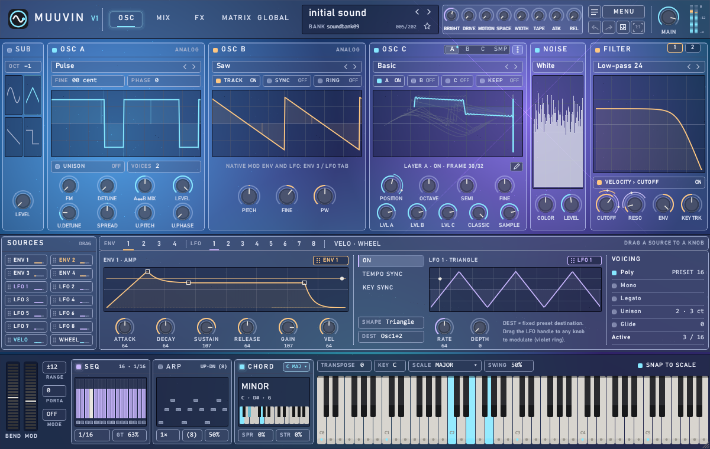
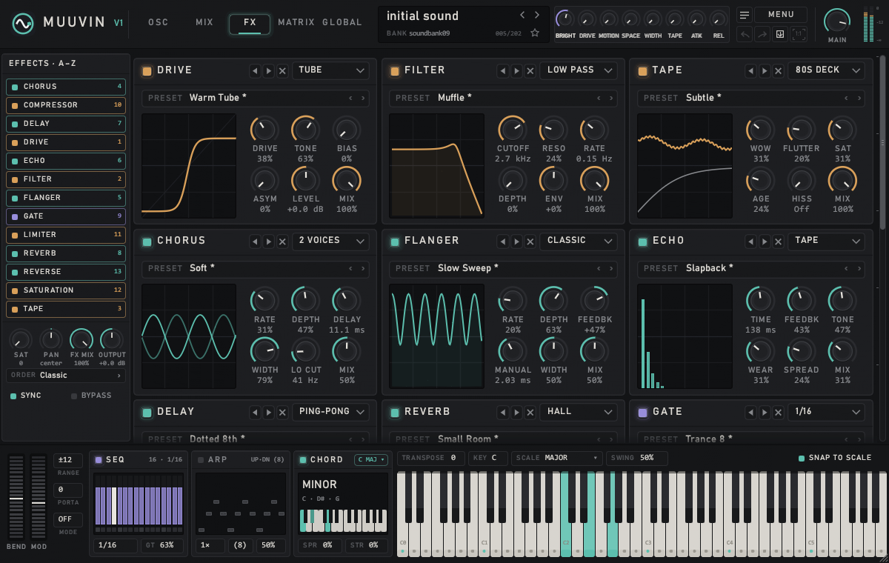
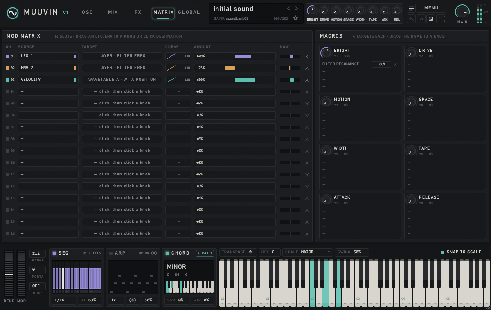
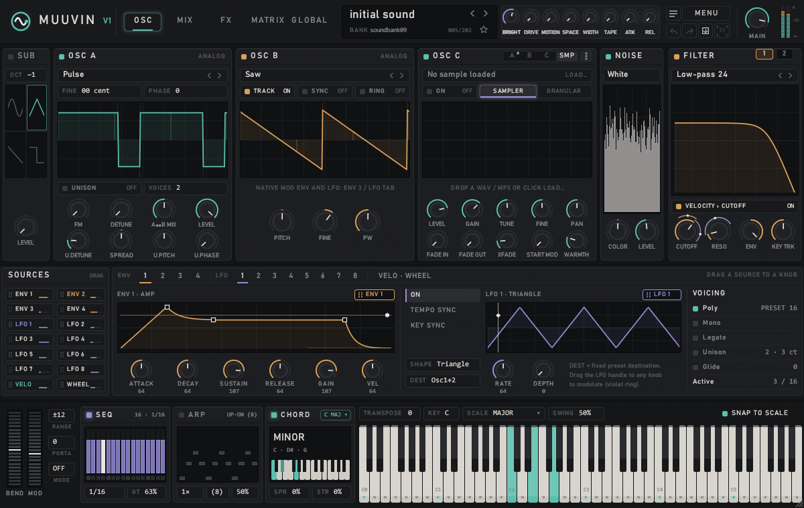
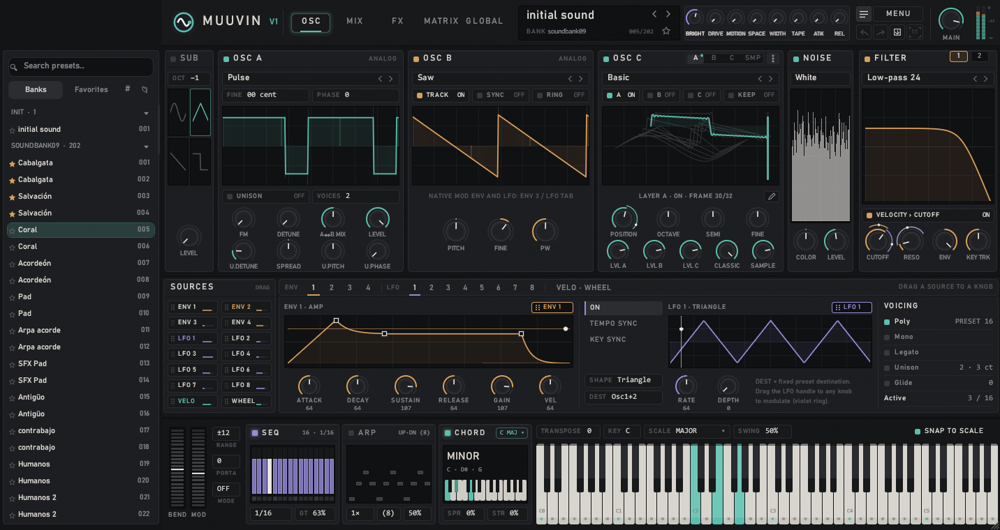

# MUUVIN V1

**A warm, analog-style synthesizer by MUUVIN SOFTWARE** · VST3 · Windows 64-bit

> 🧪 **Public testing phase.** MUUVIN V1 is still being tested. It is stable enough to make music with, and we are polishing it day by day. **Your opinion matters a lot to us**: every bug report, idea and comment helps shape the final version. See [Contact us](#contact-us-bugs-feature-requests-and-feedback).

---

## About MUUVIN SOFTWARE

MUUVIN SOFTWARE is an independent audio software company. We make instruments for producers who care about how a sound *feels*, not only how it looks on screen.

We build everything ourselves: the sound engine, the interface and the presets. Every product follows one idea: an instrument should sound warm and alive the moment you open it, then get out of the way while you create.

## How MUUVIN V1 was born

MUUVIN V1 started with a simple question: *what if the sounds that defined a generation of bedroom producers could live on in a modern instrument?*

For years, the legendary **Synth1** by Daichi has been one of the most loved free synths in the world. Thousands of producers built their sound with it, and tens of thousands of `.sy1` presets were shared online. We wanted those sounds to keep playing, with the same character, inside a new synth with a modern interface, wavetables, sampling and a full effects studio.

So we wrote MUUVIN V1 from scratch in Rust, a modern language chosen for speed, stability and low CPU use inside any DAW. The core follows the style of 80s analog synthesizers. Each preset in a 128-preset test bank was rendered and compared against a reference recording, so imported sounds keep their original tone. On top of that core, we added the tools we always wanted:
- three wavetable layers;
- a sampler with granular mode and slicing;
- drag-and-drop modulation;
- twelve studio effects;
- performance tools such as chords, scales, an arpeggiator and a sequencer.

MUUVIN V1 is our first instrument, and the first step in a growing line of MUUVIN instruments and effects.

## Plays the legendary Synth1 presets

MUUVIN V1 reads banks and presets made for the legendary **Synth1 by Daichi**, in the `.sy1` format: a single file, a folder or a `.zip`.

- Use **MENU › Import bank** (folder or `.zip`), or the 📁 icon in the browser to import several `.zip` files at once.
- Each bank becomes a folder in the preset browser.
- Presets play with their original sound. Each preset's own effects still play as they were made.
- The **ANALOG** controls can add warmth on top. At OFF, the preset sounds exactly like the original.
- You can also export the current preset as `.sy1`.

## Screenshots

| Oscillators | Effects rack |
|---|---|
|  |  |
| **Modulation matrix** | **Sampler & granular** |
|  |  |
| **Preset browser** | **Neon theme** |
|  |  |

## A tour of MUUVIN V1

MUUVIN V1 has five pages: **OSC, MIX, FX, MATRIX and GLOBAL**. The top bar, with navigation, the preset name, the 8 macros and the main volume, is always visible. The performance bar with the keyboard is always at the bottom.

### OSC: sound generation
- **Classic oscillators** form the core of the tone, in the style of 80s analog synthesizers. Synth1 `.sy1` presets use exactly these blocks.
  - **SUB:** sub oscillator with octave and waveform.
  - **OSC A:** Sine, Saw, Pulse or Triangle, with FM, detune and unison.
  - **OSC B:** TRACK, hard SYNC and RING modulation.
- **OSC C** adds up to three **wavetables** (A, B and C) and a **sample** to the sound, with a 3D view of the wavetable frames.
- **NOISE** adds coloured noise.
- **FILTER** offers Low-pass 12/24, High-pass 12, Band-pass 12 and Low-pass 24 Ladder, with a second filter in serial or parallel.

### Modulation you can see
In MUUVIN V1, all modulation is visual: **just drag a source onto a knob**. There are 4 envelopes, 8 LFOs (with tempo sync and key sync), velocity and the mod wheel. A coloured ring around a knob shows how much it is being modulated. Right-click a knob to set the amount and the curve (LIN, EXP or LOG), bypass a link or remove it.

### 8 macros
**BRIGHT, DRIVE, MOTION, SPACE, WIDTH, TAPE, ATTACK and RELEASE.** Drag a macro name onto any knob to control it. Each macro has up to 4 targets, each with its own amount.

### Wavetable editor
Draw and edit your own wavetables with point-level precision:
- **Tools:** pencil, line, curve, smooth, normalize, mirror and invert.
- **Harmonics mode:** add or remove harmonics with bars.
- **CHARACTER controls:** make a table sound less digital.

### Sampler, granular and slicing
Load any WAV or MP3 and play it as a sampler, or turn the audio into granular textures. The sample editor trims, cleans and slices audio with sample accuracy: equal parts, transients, tempo grid or manual. A slice can become a wavetable (SLICE › WT), and slices can be exported as WAV.

### MIX and the ANALOG section
The MIX page shows every layer and the output: level, waveform and spectrum. The **ANALOG** section gives the sound the warm, living character of a real analog synthesizer:
- **DRIFT:** each oscillator drifts slowly.
- **TOLERANCE:** each voice is slightly different in tuning and filter.
- **HEAT:** saturates the sound before the filter.

### FX: twelve studio effects + REVERSE
Load only the effects you want, in any order: **DRIVE, FILTER, TAPE, CHORUS, FLANGER, ECHO, DELAY, REVERB, GATE, multiband COMPRESSOR, LIMITER and SATURATION**, plus **REVERSE** at the end of the chain.

### Performance bar
- Pitch and mod wheels.
- A 16-step sequencer and an arpeggiator.
- One-finger chords (15 chords).
- Key and scale selection (14 scales), with **SNAP TO SCALE** to keep every note in key.

### Preset browser
Opens on the side (☰) with imported banks, the MUUVIN Factory bank (128 presets), favourites, search and tag filters (BASS, LEAD, PAD, PLUCK, KEYS, 80s, WARM, VINTAGE, CINEMA and more).

## Specifications

| | |
|---|---|
| **Format** | VST3, Windows 64-bit |
| **Developer** | MUUVIN SOFTWARE |
| **Polyphony** | Up to 16 voices · Poly, Mono, Legato · Unison |
| **Classic oscillators** | OSC A (Sine, Saw, Pulse, Triangle), OSC B (Saw, Pulse, Triangle, Noise) and SUB · FM, Sync and Ring |
| **Wavetables** | 3 layers (A, B, C) · 8 factory tables · 32 frames × 2048 points · built-in editor |
| **Sampler & granular** | WAV and MP3 · looping sampler · granular · slicing (equal, transients, grid, manual) |
| **Noise** | Noise generator with colour and level |
| **Filters** | 2 filters (serial or parallel): LP12, LP24, HP12, BP12 and LP24 Ladder |
| **Envelopes** | 4 (amp, filter, modulation and free) |
| **LFOs** | 8 · Saw, Triangle, Square, S&H, Random and Sine · tempo sync · key sync |
| **Modulation** | Drag and drop · 16-slot matrix with curve and bypass · 8 macros × 4 targets |
| **Analog character** | DRIFT, TOLERANCE and HEAT |
| **Effects** | 12 reorderable + REVERSE |
| **Performance** | 16-step sequencer · arpeggiator · 15 chords · 14 scales · snap to scale |
| **Presets** | Reads banks and presets from the legendary Synth1 by Daichi (`.sy1`: file, folder or `.zip`) · factory bank MUUVIN Factory (128) |
| **Interface** | 5 pages · 75% to 110% size · 5 themes · Português and English · built-in manual |

## Getting started

1. **Install:** copy the `MUUVIN V1.vst3` folder to `C:\Program Files\Common Files\VST3` and reopen your DAW. MUUVIN V1 shows up as an instrument by MUUVIN SOFTWARE. Close the DAW before updating the plugin.
2. **Play:** create an instrument track with MUUVIN V1. The *initial sound* preset is a clean starting point.
3. **Browse:** click ☰ to open the browser. The MUUVIN Factory bank comes preinstalled.
4. **Import your Synth1 banks:** MENU › Import bank (folder or `.zip`).
5. **Save:** click the save icon in the top bar. Your DAW project also stores everything, including samples and slices.

The full manual, in English and Portuguese, opens inside the plugin: **MENU › USER MANUAL**.

## Contact us: bugs, feature requests and feedback

MUUVIN V1 is **still in testing**, and **your opinion is essential** to us. Get in touch by opening an [issue](../../issues).

### Found a bug?
If something doesn't sound or work as expected, please let us know. Tell us:
- what happened and what you expected;
- your DAW and Windows version;
- the preset or `.sy1` file involved, if any;
- a screenshot or short recording, if you can.

### Have an idea for a feature?
We'd love to hear it: a new effect, a modulation option, a workflow shortcut or anything that would help your music.

### Want to share your opinion?
Tell us what you think of MUUVIN V1: the sound, the presets, the interface, what you love and what could be better.

We read every message. Fixes and new features are delivered in upcoming updates.

---

© MUUVIN SOFTWARE. All rights reserved.
*Synth1 is a product of Daichi Laboratory. MUUVIN SOFTWARE is not affiliated with Daichi Laboratory; MUUVIN V1 only reads the Synth1 preset file format.*
