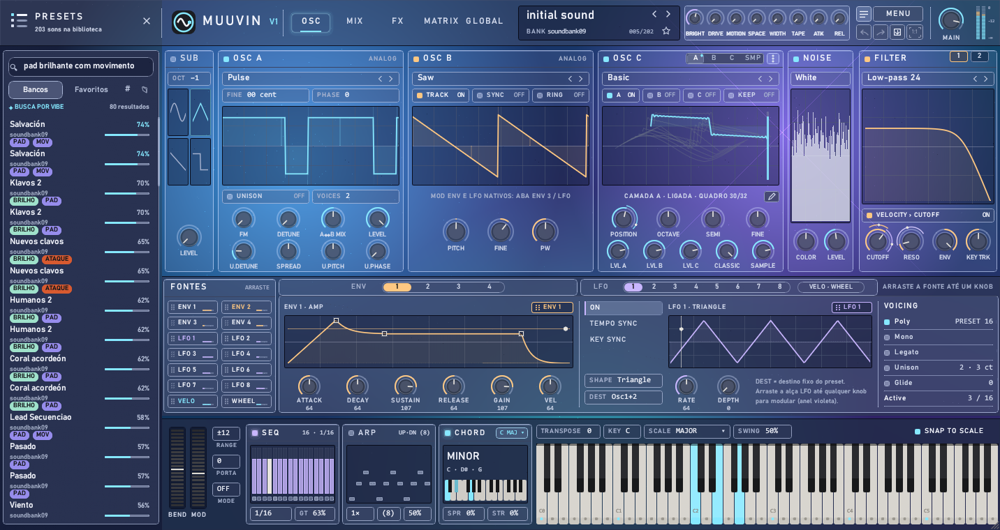
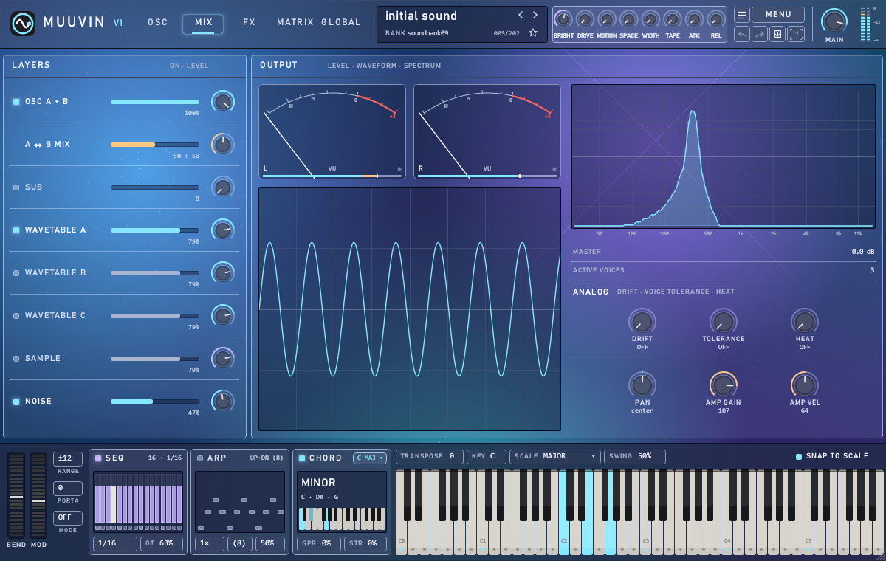
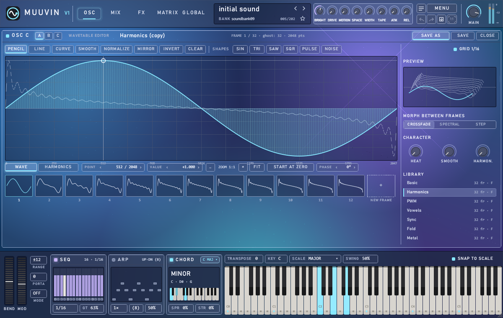
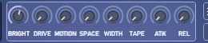
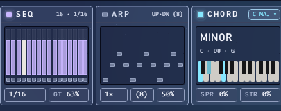
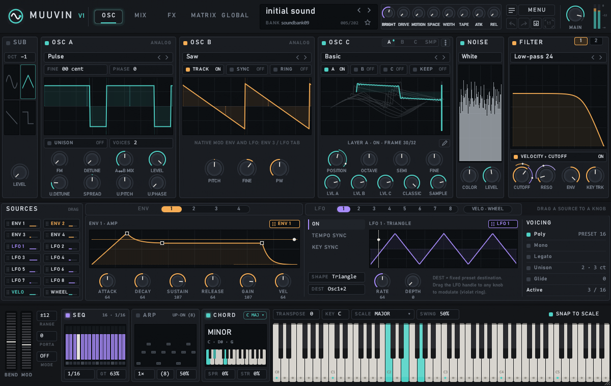
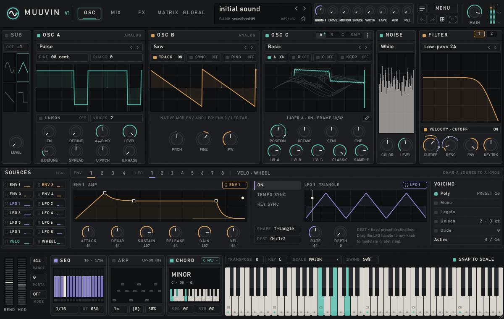
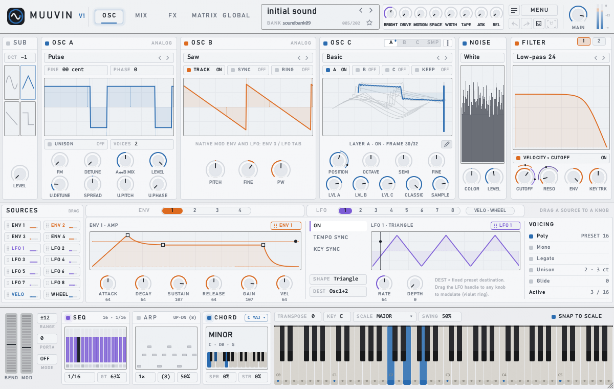
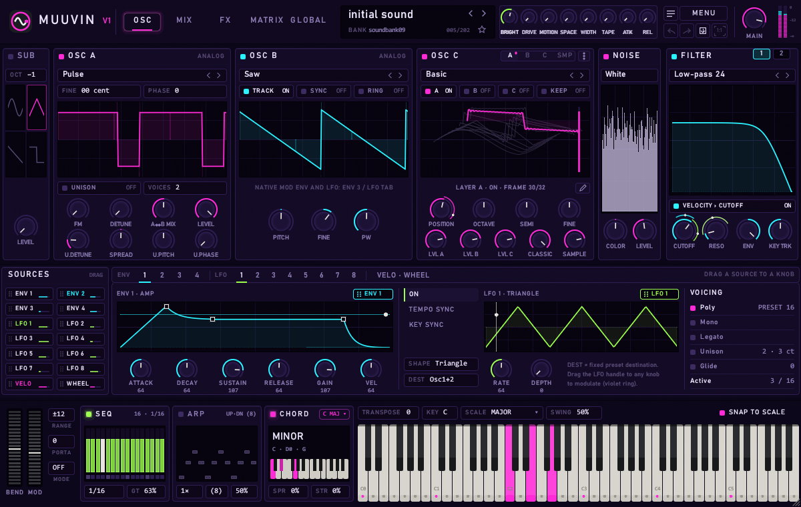

# MUUVIN V1

### A warm, analog-style synthesizer by MUUVIN SOFTWARE

**[⬇ Download](../../releases/latest)** · **[📖 Manual (EN)](manuals/MUUVIN_V1_Manual_EN.pdf)** · **[📖 Manual (PT)](manuals/MUUVIN_V1_Manual_PT.pdf)** · **[🐞 Report / Request](../../issues)**

---

> ## 🧪 This is a BETA — not the final version
>
> **MUUVIN V1 is in a public testing phase.** It is stable enough to make music with, but it is **a work in progress and not the final release.** Some things may still change, and you may run into rough edges.
>
> **This is exactly why we need you.** Every bug report, feature idea and comment directly shapes the final version — see **[Contact us](#contact-us)**.
>
> **We are committed to updating MUUVIN V1 as quickly as possible** — fixes and improvements ship as fast as we can, so the plugin keeps getting better with every release.

---

## Download & install

**[⬇ Download the latest build from Releases](../../releases/latest)**

Download **MUUVIN V1 - Installer + Manuals.zip** from the latest release. It contains the installer and both manuals.

1. **Close your DAW.**
2. Run **`MUUVIN V1 Installer.exe`** and follow the wizard (administrator rights required).
3. Open your DAW, rescan your plugins, and find **MUUVIN V1** under **MUUVIN SOFTWARE**.

**Prefer a manual install?** The release also includes **MUUVIN V1 (VST3 plugin only).zip** — unzip the `MUUVIN V1.vst3` folder into `C:\Program Files\Common Files\VST3\MUUVIN SOFTWARE\` yourself.

The full manual (English and Portuguese) is also built into the plugin: **MENU › USER MANUAL**.

---

## About MUUVIN SOFTWARE

**MUUVIN SOFTWARE is an independent audio software company based in Brazil.** 🇧🇷

We make instruments for producers who care about how a sound *feels*, not only how it looks on screen. We build everything ourselves — the sound engine, the interface and the presets — around one idea: an instrument should sound warm and alive the moment you open it, then get out of the way while you create.

> **Our wish for MUUVIN V1 is simple: that it helps spark your creativity.** We want it to inspire you to play, experiment and find new ideas — a tool that moves your music forward, not one that gets in your way.

## How MUUVIN V1 was born

MUUVIN V1 started with a simple question: *what if the sounds that defined a generation of producers could live on in a modern instrument?*

For years, the legendary **Synth1** by Daichi has been one of the most loved synthesizers in the world. Countless producers built their sound with it, and tens of thousands of `.sy1` presets were shared online. We wanted those sounds to keep playing — with the same character — inside a new synth with a modern interface, wavetables, sampling and a full effects studio.

So we wrote MUUVIN V1 from scratch in **Rust**, chosen for speed, stability and low CPU use inside any DAW. The core follows the style of 80s analog synthesizers, and imported presets are rendered to preserve their original tone. On top of that core, we added the tools we always wanted.

MUUVIN V1 is our first instrument, and the first step in a growing line of MUUVIN instruments and effects.

## Plays the legendary Synth1 presets

MUUVIN V1 reads banks and presets made for the legendary **Synth1 by Daichi**, in the `.sy1` format — a single file, a folder or a `.zip`.

- Use **MENU › Import bank** (folder or `.zip`), or the 📁 icon in the browser to import several `.zip` files at once.
- Each bank becomes a folder in the preset browser.
- Presets play with their original sound, and each preset's own effects still play as they were made.
- The **ANALOG** controls can add warmth on top. At **OFF**, the preset sounds exactly like the original.
- You can also export the current preset as `.sy1`.

The factory bank, **MUUVIN Analog Dreams** (400 presets), is permanent and sorted by category: arps, brass, basses, leads, noise/FX, pads, sequences and synths.

---

## ✦ Search presets by *vibe* — **new in 1.2**

Stop scrolling through hundreds of names. **Describe the sound you want in plain words** and MUUVIN V1 finds the closest presets for you.

Type something like **`warm analog bass`**, **`bright pad with movement`** or **`short plucky lead`** into the browser search field. MUUVIN V1 reads what each preset actually *does* — brightness, attack, harmonics, movement, low end, density — and ranks the library by how well it matches, showing a **relevance score** and **vibe tags** (GRAVE, QUENTE, ANALÓG, PAD, MOV, LARGO…) on each result.

- **No internet, no AI, no waiting.** It all runs locally inside the plugin — instant and private. Works fully offline.
- **It understands English and Portuguese** vibe words out of the box.
- **It respects your tabs and filters.** Search inside *Banks* or *Favourites*, combine it with the `#` tag filters — it just reorders what is already there by feel.
- Type ordinary preset names and it still works as a normal name search.

One field, two ways to search: by name *and* by the sound you are after.

---

## Screenshots

| Oscillators | Effects rack |
|:---:|:---:|
|  |  |
| **Modulation matrix** | **Mixer & analog character** |
|  |  |
| **Preset browser** | **Sampler & granular** |
|  |  |

---

## Sampler with precise, professional slicing

MUUVIN V1 is more than a preset player — it is a full **sampling and slicing instrument.**

- **Load any WAV or MP3** and play it as a looping sampler, or turn the audio into lush **granular** textures.
- **Precise, professional slicing** in the built-in sample editor, with **sample-accurate** control:
  - slice by **equal parts**, by **transients** (with adjustable sensitivity), on the **tempo grid**, or **manually**;
  - double-click to add a slice, drag to move it, right-click to remove it;
  - clean and shape audio with normalize, reverse, trim, fade, DC offset, crop-loop, **detect root note**, snap to zero-cross and snap to grid.
- **Turn a slice into a wavetable** (SLICE › WT), use slices in the granular engine, or **export the slices as WAV**.

Perfect for chopping drum loops, building instruments from field recordings, or re-pitching vocal cuts with precision.

## Wavetable editor

Draw and edit your own wavetables with **point-level precision** (2048 points per frame, up to 32 frames):

- **Tools:** pencil, line, curve, smooth, normalize, mirror, invert and clear.
- **Shapes:** start from Sine, Triangle, Saw, Pulse or Noise and refine from there.
- **Harmonics mode:** add or remove harmonics with bars; Alt-drag changes the phase.
- **CHARACTER controls** (Warmth, Smooth, Harmon.) make a table sound less digital.
- **Morph** between frames with crossfade, spectral or step modes.

---

## A tour of MUUVIN V1

MUUVIN V1 has five pages — **OSC, MIX, FX, MATRIX and GLOBAL**. The top bar is always visible, and the performance bar with the keyboard is always at the bottom.

### OSC — sound generation
- **Classic oscillators** form the core of the tone, in the style of 80s analog synthesizers. Synth1 `.sy1` presets use exactly these blocks.
  - **SUB:** sub oscillator with octave and waveform.
  - **OSC A:** Sine, Saw, Pulse or Triangle, with FM, detune and unison.
  - **OSC B:** TRACK, hard SYNC and RING modulation.
- **OSC C** adds up to three **wavetables** (A, B and C) and a **sample**, with a 3D view of the wavetable frames.
- **NOISE** adds coloured noise, and **FILTER** offers Low-pass 12/24, High-pass 12, Band-pass 12 and Low-pass 24 Ladder, with a second filter in serial or parallel.

### Modulation you can see
All modulation is visual: **just drag a source onto a knob.** There are 4 envelopes, 8 LFOs (with tempo sync and key sync), velocity and the mod wheel. A coloured ring around a knob shows how much it is being modulated. Right-click a knob to set the amount and curve (LIN, EXP or LOG), bypass a link or remove it.

### 8 macros, one drag away

**BRIGHT · DRIVE · MOTION · SPACE · WIDTH · TAPE · ATTACK · RELEASE.** The eight macro knobs sit in the top bar, ready to animate your sound. **Drag a macro name onto any knob** to control it — each macro drives up to 4 targets, each with its own amount. One gesture turns a static preset into a performance.

### Performance — SEQ, ARP and CHORD

The performance bar is always at the bottom:

- **SEQ** — a 16-step sequencer; click the bars to edit, and set the division and gate.
- **ARP** — an arpeggiator with modes (UP·DN and more), octave range and swing.
- **CHORD** — one-finger chords: pick a chord (15 available) and play a single note to hear the whole voicing.
- **Key & scale** (14 scales) with **SNAP TO SCALE** to keep every note you play in key.

### FX — twelve studio effects + REVERSE
Load only the effects you want, in any order: **DRIVE, FILTER, TAPE, CHORUS, FLANGER, ECHO, DELAY, REVERB, GATE, multiband COMPRESSOR, LIMITER and SATURATION**, plus **REVERSE** at the end of the chain.

### MIX and the ANALOG section
The MIX page shows every layer and the output — level, waveform and spectrum. The **ANALOG** section adds the warm, living character of a real analog synth: **DRIFT** (slow oscillator drift), **TOLERANCE** (per-voice tuning/filter variation) and **HEAT** (saturation before the filter). At **OFF**, a preset sounds exactly like the original.

---

## Five themes

Make MUUVIN V1 look the way you want — **Glass** is the default.

| Glass *(default)* | Graphite | Slate |
|:---:|:---:|:---:|
|  |  |  |
| **Light** | **Neon** | |
|  |  | |

The interface also scales from **75% to 110%**, with a 1:1 button to return to the original size.

---

## Specifications

| | |
|---|---|
| **Format** | VST3, Windows 64-bit |
| **Developer** | MUUVIN SOFTWARE (Brazil) |
| **Status** | Public beta (in testing — not the final version) |
| **Polyphony** | Up to 16 voices · Poly, Mono, Legato · Unison |
| **Classic oscillators** | OSC A (Sine, Saw, Pulse, Triangle), OSC B (Saw, Pulse, Triangle, Noise) and SUB · FM, Sync and Ring |
| **Wavetables** | 3 layers (A, B, C) · 8 factory tables · 32 frames × 2048 points · built-in editor |
| **Sampler & granular** | WAV and MP3 · looping sampler · granular · precise slicing (equal, transients, grid, manual) · export slices as WAV |
| **Noise** | Noise generator with colour and level |
| **Filters** | 2 filters (serial or parallel): LP12, LP24, HP12, BP12 and LP24 Ladder |
| **Envelopes** | 4 (amp, filter, modulation and free) |
| **LFOs** | 8 · Saw, Triangle, Square, S&H, Random and Sine · tempo sync · key sync |
| **Modulation** | Drag and drop · 16-slot matrix with curve and bypass · 8 macros × 4 targets |
| **Analog character** | DRIFT, TOLERANCE and HEAT |
| **Effects** | 12 reorderable + REVERSE |
| **Performance** | 16-step sequencer · arpeggiator · 15 chords · 14 scales · snap to scale |
| **Presets** | Reads Synth1 `.sy1` banks and presets (file, folder or `.zip`) · factory bank MUUVIN Analog Dreams (400) |
| **Interface** | 5 pages · 75%–110% size · 5 themes · English & Português · built-in manual |

<h2 id="contact-us">Contact us — bugs, feature requests & feedback</h2>

MUUVIN V1 is **still in testing**, and **your opinion is essential.** Get in touch by opening an **[issue](../../issues)**.

**🐞 Found a bug?** Tell us what happened and what you expected, your DAW and Windows version, the preset or `.sy1` file involved, and a screenshot or short recording if you can.

**💡 Have an idea for a feature?** A new effect, a modulation option, a workflow shortcut — we'd love to hear it.

**💬 Want to share your opinion?** Tell us what you think of the sound, the presets and the interface: what you love, and what could be better.

We read every message, and we are committed to **updating MUUVIN V1 as quickly as possible** — fixes and new features ship as fast as we can.

---

**© MUUVIN SOFTWARE — Made in Brazil 🇧🇷 — All rights reserved.**

Synth1 is a product of Daichi Laboratory. MUUVIN SOFTWARE is not affiliated with Daichi Laboratory; MUUVIN V1 only reads the Synth1 preset file format.

